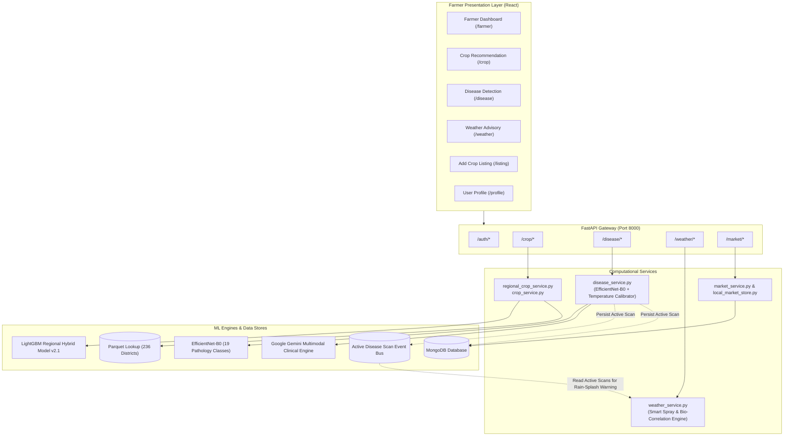
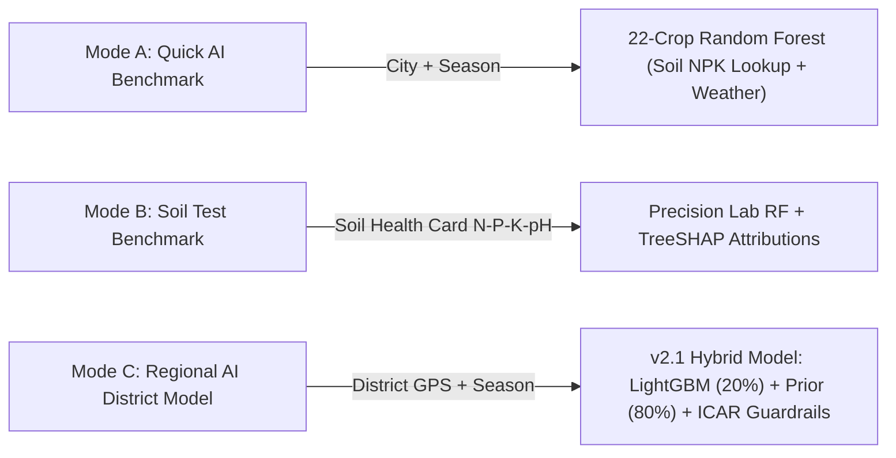
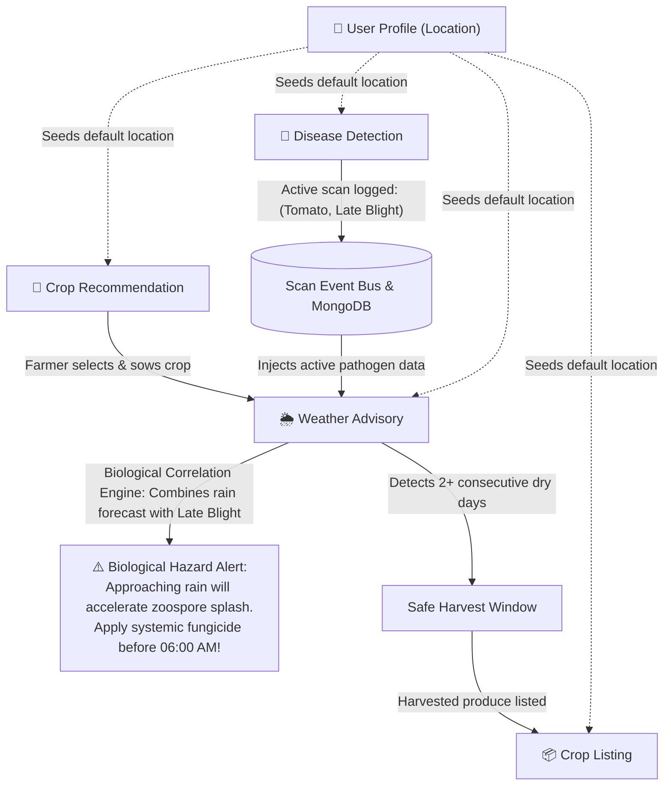
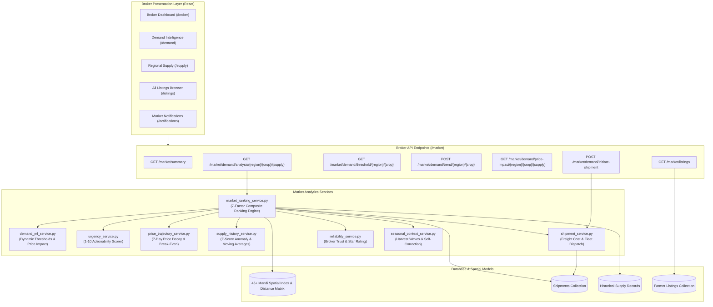
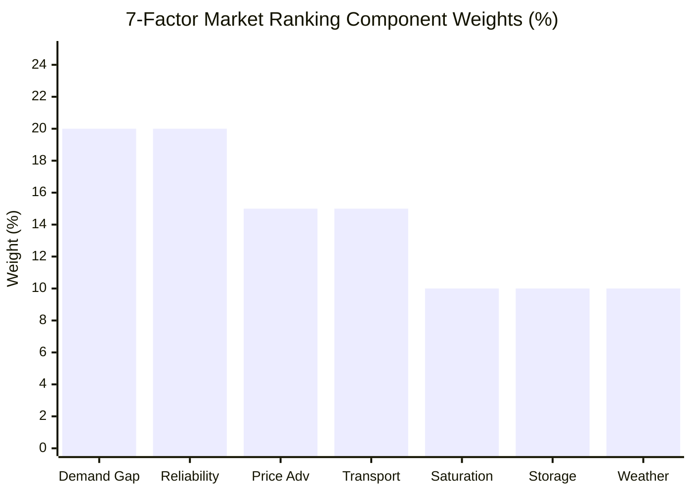
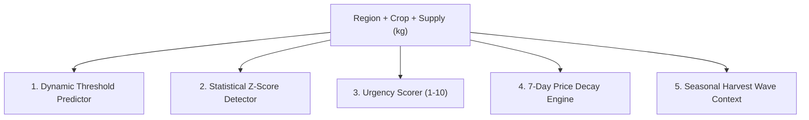
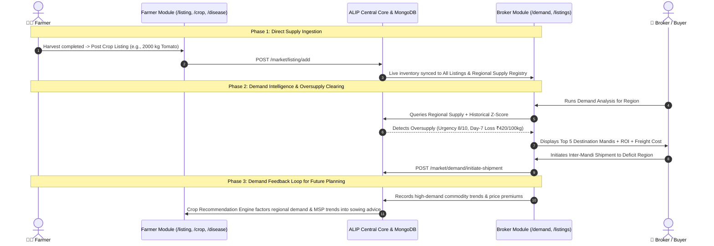

# ALIP Master Architecture & Technical Report: Farmer & Broker Modules

**Platform:** AgriLink Intelligence Platform (ALIP)  
**Target User Personas:** Indian Agricultural Producers (Farmers) & Commercial Commodity Traders (Brokers)  
**System Version:** `v2.1-hybrid`  
**Document Status:** Master System Architecture & Functional Specification  
**Date:** October 2026  

---

# PART 1: THE FARMER MODULE

## 1. Overview & Lifecycle Mission
The **Farmer Module** in ALIP (AgriLink Intelligence Platform) is an end-to-end agricultural decision-support system. It accompanies smallholders, commercial growers, and Farmer Producer Organizations (FPOs) through the entire four-stage agricultural lifecycle:

$$\text{Pre-Sowing (Crop AI)} \longrightarrow \text{In-Season (Pathology AI)} \longrightarrow \text{Daily Care (Weather Ops)} \longrightarrow \text{Harvest (Market Listing)}$$

---

## 2. Technology Stack & Frameworks
| Layer | Technologies & Libraries |
| :--- | :--- |
| **Frontend UI** | React 19, React Router v6, Axios (with JWT interceptors), Framer Motion, Lucide React, React Hot Toast |
| **Backend API** | FastAPI (Python 3.10 asynchronous execution), Pydantic v2 data validation schemas |
| **Deep Learning Vision** | PyTorch, `torchvision` EfficientNet-B0, PIL image processing |
| **Tabular Machine Learning** | LightGBM, XGBoost, Scikit-Learn (Random Forest, Isotonic Regression), SHAP (`TreeExplainer`) |
| **External Environmental APIs** | OpenWeatherMap API, Open-Meteo ERA5 Reanalysis, ISRIC SoilGrids REST API, Google GenAI SDK |
| **Persistence & Columnar Caches** | MongoDB (scans, listings, users) + Bounded In-Memory Event Cache + Parquet Columnar Files |

---

## 3. High-Level Architecture (Farmer Module)



---

## 4. Detailed Breakdown of Farmer Features

### Feature 1: Crop Recommendation Engine (`/crop`)
Offers three operational tiers for varying farmer capabilities:



1. **Mode A — Quick AI Benchmark (Auto Mode):**
   - Inputs: Location and Season (Kharif, Rabi, Summer).
   - Mechanism: Retrieves regional soil chemistry baselines ($N, P, K, \text{pH}$) and queries OpenWeatherMap; runs Random Forest across 22 crops.
   - Output: Ranked crops, agronomic duration, sowing/harvest windows, water requirement, and Minimum Support Price (MSP).
2. **Mode B — Soil Test Benchmark (Manual Mode):**
   - Inputs: Nitrogen ($N$), Phosphorus ($P$), Potassium ($K$), Soil pH, Temperature, Humidity, Rainfall from a Soil Health Card (SHC).
   - Mechanism: Evaluates precise chemical concentrations; renders a **SHAP Feature Impact Panel** displaying each nutrient's contribution.
3. **Mode C — Regional AI District Model (`v2.1-regional-hybrid`):**
   - Inputs: District name or GPS coordinates ($\le 50\text{ km}$ Haversine cutoff) and Season.
   - Mechanism: Maps to a 25-dimensional biophysical vector (10-year ERA5 climate normals, SoilGrids chemistry, DES irrigation ratio, and 15 one-hot candidate field crops).
   - Scoring: Convex combination of calibrated LightGBM ($P_{\text{ML}}$) and empirical district frequency ($P_{\text{prior}}$):
     $$S_{\text{hybrid}} = 0.20 \cdot P_{\text{ML}} + 0.80 \cdot P_{\text{prior}} \quad (\text{Validation-Tuned } \alpha = 0.20)$$
     Achieves **$\text{NDCG@3} = 0.9128$** and **$\text{Recall@3} = 0.9316$**.
   - Guardrails: Enforces ICAR rules (hard exclusions for seasonal mismatches; soft flags for heat, drought, or extreme pH).
   - Output: Rank Score / Suitability Index with dynamic data provenance and non-causal SHAP explanations.

### Feature 2: AI Leaf Disease Detection (`/disease`)
1. **Model Pipeline:** Deep CNN (**EfficientNet-B0**) with custom dropout ($p=0.40$) and linear classification head trained across **19 classes** for 4 staple crops:
   - **Tomato:** Bacterial Spot, Early Blight, Late Blight, Leaf Mold, Septoria Leaf Spot, Spider Mites, Target Spot, Mosaic Virus, Yellow Leaf Curl Virus, Healthy.
   - **Potato:** Early Blight, Late Blight, Healthy.
   - **Corn / Maize:** Common Rust, Northern Leaf Blight, Cercospora Gray Leaf Spot, Healthy.
   - **Pepper / Chilli:** Bacterial Spot, Healthy.
2. **Calibration & Rejection Gate:** Temperature-scaled Softmax ($T = 1.15$):
   - $\ge 80\%$: High confidence diagnosis.
   - $60\% - 79\%$: Low confidence warning; advises secondary inspection.
   - $< 60\%$: Automated rejection (*"Please upload a clear, close-up photo of a single crop leaf"*).
3. **Weather-Fused Clinical Reports (Google Gemini API):** Injects live microclimate into generative prompts to generate a 3-Screen Clinical Advisory:
   - **Screen 1 (Action Plan):** Urgency timeframe (e.g., *"Action within 24 hours"*), tiered chemical treatments (🥇 1st Choice, 🥈 2nd Choice, 🥉 3rd Choice with exact chemicals such as Metalaxyl-M, Cymoxanil, Mancozeb), and daily action checklists.
   - **Screen 2 (Prevention & FAQ):** Environmental catalyst analysis and interactive FAQ.
   - **Screen 3 (Technical Report):** Pathological summary, confidence percentage, severity rating, and microclimate factors.

### Feature 3: Dynamic Weather Advisory & Farm Operations Engine (`/weather`)
1. **Farm Suitability Score (0–100):** Real-time aggregation of thermal comfort, humidity, wind velocity, and precipitation.
2. **Dynamic 48-Hour Spray Window Engine:** Scans hourly forecast slots to isolate safe pesticide application windows ($\text{wind} < 12\text{ km/h}$, $\text{rain} = 0$, $\text{humidity} < 85\%$).
3. **Irrigation Advisory:** Analyzes soil saturation and 24–48h rain forecasts to recommend "Skip", "Delay", or "Irrigate normally".
4. **Fertilizer Runoff Warning:** Flags fertilization as `unsafe` if $> 2\text{ mm}$ rain is forecast within 24 hours to prevent nutrient leaching.
5. **Harvest Window Detector:** Scans the 5-day horizon for $2+$ consecutive dry days ($\text{rain} = 0\text{ mm}$, $\text{humidity} < 80\%$).
6. **7-Day Cumulative Rainfall & Soil Saturation:** Classifies soil moisture as *Dry*, *Moist*, *Wet*, or *Saturated* (waterlogged).

### Feature 4: Direct Crop Marketplace Listing (`/listing`)
- Allows farmers to list harvested crops with farmer name, location, crop variety, quantity in kg, target price (₹/kg), and contact details.
- Automatically pushes entries into the **Broker Regional Supply Registry**.

### Feature 5: Farmer Profile & Central Management (`/profile`)
- Displays identity verification (`👨‍🌾 Farmer` badge) and tracks historical usage (Disease Scans completed, Weather Checks, Crop Recommendations, Active Listings).
- Updating the farmer's primary district re-centers weather queries, crop models, and mandi prices across the app.

---

## 5. Inter-Feature Connectivity within the Farmer Module

The Farmer Module's subcomponents operate as a cohesive feedback loop:



---
---

# PART 2: THE BROKER MODULE

## 1. Overview & Trading Mission
The **Broker Module** is ALIP's commercial intelligence and market-clearing engine. It is designed for commission agents, commodity traders, agri-logistics coordinators, and institutional buyers. Its mission is to **eliminate spatial market failure** (where one district suffers price collapse from localized gluts while a neighbouring district faces shortages and price spikes) through AI-driven redistribution, transport optimization, and broker-to-broker deal settlement.

---

## 2. Technology Stack & Frameworks
| Layer | Technologies & Libraries |
| :--- | :--- |
| **Frontend UI** | React 19, Recharts (AreaChart, LineChart, ReferenceLines), Axios, Custom CSS Modules |
| **Backend API** | FastAPI asynchronous sub-routers (`/market/*`, `/market/regions/*`), Pydantic models |
| **Logistics & Spatial Engine** | Haversine distance matrix across 45+ Indian mandis, route cost optimizers |
| **Predictive Analytics** | Time-series momentum engines, 7-day price decay models, Z-score anomaly detectors |
| **Persistence Layer** | MongoDB collections (`crop_listings`, `shipments`, `supply_history`, `broker_ratings`) + In-memory stores |

---

## 3. High-Level Architecture (Broker Module)



---

## 4. Detailed Breakdown of Broker Features

### Feature 1: Market Overview & Broker Dashboard (`/broker`)
Provides aggregate market health metrics upon login:
- **Total Market Volume:** Live cumulative tonnage of produce available.
- **Active Farmer Listings:** Number of pending listings across all districts.
- **Oversupply Alerts:** Districts where local arrivals exceed dynamic absorption thresholds.
- **Undersupply Alerts:** Mandis facing deficits where prices are escalating.
- **Quick-Access Navigation:** Direct routing to Demand Analysis, All Listings, Regional Supply, Add Listing, and Notifications.

---

### Feature 2: 7-Factor Weighted Market Ranking Engine (`/demand`)
The core algorithmic component of the Broker Module (`market_ranking_service.py`). When an oversupplied region and crop are analyzed, the system evaluates all reachable destinations (within $500\text{ km}$) and calculates a unified composite suitability score ($S_i \in [0, 100]$):

$$S_{\text{composite}} = \sum_{k=1}^{7} w_k \cdot f_k$$

<div align="center">
<svg viewBox="0 0 520 320" width="100%" max-width="520" height="320" xmlns="http://www.w3.org/2000/svg">
  <!-- Slices centered at (160, 160), Radius 130 -->
  <!-- 1. Demand Gap: 20% (72 deg, 0 to 72) -->
  <path d="M 160 160 L 290 160 A 130 130 0 0 1 200.17 283.63 Z" fill="#3b82f6" stroke="#0f172a" stroke-width="2" />
  <!-- 2. Broker Reliability: 20% (72 deg, 72 to 144) -->
  <path d="M 160 160 L 200.17 283.63 A 130 130 0 0 1 54.83 236.41 Z" fill="#10b981" stroke="#0f172a" stroke-width="2" />
  <!-- 3. Price Advantage: 15% (54 deg, 144 to 198) -->
  <path d="M 160 160 L 54.83 236.41 A 130 130 0 0 1 36.36 119.83 Z" fill="#f59e0b" stroke="#0f172a" stroke-width="2" />
  <!-- 4. Transport Efficiency: 15% (54 deg, 198 to 252) -->
  <path d="M 160 160 L 36.36 119.83 A 130 130 0 0 1 119.83 36.36 Z" fill="#8b5cf6" stroke="#0f172a" stroke-width="2" />
  <!-- 5. Destination Saturation: 10% (36 deg, 252 to 288) -->
  <path d="M 160 160 L 119.83 36.36 A 130 130 0 0 1 200.17 36.36 Z" fill="#ef4444" stroke="#0f172a" stroke-width="2" />
  <!-- 6. Storage Availability: 10% (36 deg, 288 to 324) -->
  <path d="M 160 160 L 200.17 36.36 A 130 130 0 0 1 265.17 83.59 Z" fill="#06b6d4" stroke="#0f172a" stroke-width="2" />
  <!-- 7. En-Route Weather Risk: 10% (36 deg, 324 to 360) -->
  <path d="M 160 160 L 265.17 83.59 A 130 130 0 0 1 290 160 Z" fill="#ec4899" stroke="#0f172a" stroke-width="2" />
  <!-- Center Hole for Donut Look -->
  <circle cx="160" cy="160" r="55" fill="#0f172a" stroke="#1e293b" stroke-width="2"/>
  <text x="160" y="155" text-anchor="middle" fill="#94a3b8" font-size="11" font-family="sans-serif">7 FACTORS</text>
  <text x="160" y="173" text-anchor="middle" fill="#f8fafc" font-size="14" font-weight="bold" font-family="sans-serif">100%</text>

  <!-- Legend -->
  <g transform="translate(320, 30)">
    <rect x="0" y="0" width="14" height="14" rx="3" fill="#3b82f6" />
    <text x="22" y="12" fill="#e2e8f0" font-size="12" font-family="sans-serif">Demand Gap (20%)</text>

    <rect x="0" y="28" width="14" height="14" rx="3" fill="#10b981" />
    <text x="22" y="40" fill="#e2e8f0" font-size="12" font-family="sans-serif">Reliability (20%)</text>

    <rect x="0" y="56" width="14" height="14" rx="3" fill="#f59e0b" />
    <text x="22" y="68" fill="#e2e8f0" font-size="12" font-family="sans-serif">Price Advantage (15%)</text>

    <rect x="0" y="84" width="14" height="14" rx="3" fill="#8b5cf6" />
    <text x="22" y="96" fill="#e2e8f0" font-size="12" font-family="sans-serif">Transport Efficiency (15%)</text>

    <rect x="0" y="112" width="14" height="14" rx="3" fill="#ef4444" />
    <text x="22" y="124" fill="#e2e8f0" font-size="12" font-family="sans-serif">Dest Saturation (10%)</text>

    <rect x="0" y="140" width="14" height="14" rx="3" fill="#06b6d4" />
    <text x="22" y="152" fill="#e2e8f0" font-size="12" font-family="sans-serif">Storage Match (10%)</text>

    <rect x="0" y="168" width="14" height="14" rx="3" fill="#ec4899" />
    <text x="22" y="180" fill="#e2e8f0" font-size="12" font-family="sans-serif">Weather Risk (10%)</text>
  </g>
</svg>
<p><em>Figure: Visual Pie Chart of the 7 Analytical Weights Driving Market Ranking.</em></p>
</div>



| Factor ($f_k$) | Weight ($w_k$) | Formula / Evaluation Logic |
| :--- | :---: | :--- |
| **Demand Gap** | **$0.20$** | $\text{Score} = \min\left(100, \frac{\text{Deficit}_{\text{dest}}}{\text{Oversupply}_{\text{source}}} \times 100\right)$. Rewards destinations capable of absorbing volume. |
| **Broker Reliability** | **$0.20$** | Historical delivery rate, dispute frequency, and peer ratings ($\text{Reliability} \in [0, 100]$). |
| **Price Advantage** | **$0.15$** | Net spatial arbitrage spread: $\Delta P = P_{\text{dest}} - P_{\text{source}}$. Higher price differentials yield higher scores. |
| **Transport Efficiency** | **$0.15$** | Freight cost per 100 kg evaluated against haul distance: $\text{Score} = \max\left(0, 100 - \frac{\text{Cost}_{100\text{kg}}}{5}\right)$. |
| **Destination Saturation** | **$0.10$** | Prevents cascading oversupply: $\text{Ratio} = \frac{\text{In-Transit Inventory}}{\text{Destination Deficit}}$. If incoming shipments fill $>120\%$ of the gap, the score drops to $0$. |
| **Storage Availability** | **$0.10$** | Validates facility compatibility. Tier 1 perishable crops (Tomato, Banana) require Cold Storage; Tier 2 crops (Potato, Onion) require Dry Warehouses. |
| **En-Route Weather** | **$0.10$** | Assesses transit weather risk (heavy rainfall, washouts, extreme heat) that could degrade perishable cargo. |

---

### Feature 3: Demand Intelligence & Predictive Sub-Services



1. **Dynamic Absorption Threshold Engine (`demand_ml_service.py`):**
   - Traditional systems rely on static thresholds. ALIP computes dynamic demand capacity based on:
     $$\text{Threshold}_{\text{crop}} = \text{Base}_{\text{crop}} \times M_{\text{region\_type}} \times M_{\text{density}} \times M_{\text{market\_size}}$$
   - Urban centers with high population density are allocated higher capacity thresholds than rural feeder mandis.
2. **Statistical Z-Score & Supply Anomaly Detection (`supply_history_service.py`):**
   - Compares incoming volume against historical rolling distributions:
     $$Z = \frac{\text{Current Supply} - \mu_{\text{history}}}{\sigma_{\text{history}}}$$
   - Identifies whether an influx represents normal variation ($Z < 1.0$), an elevated arrival ($1.0 \le Z < 2.0$), or a critical market anomaly ($Z \ge 2.0$).
3. **Multi-Signal Urgency Scorer (`urgency_service.py`):**
   - Computes an actionability score from $1$ to $10$ indicating how rapidly a broker must liquidate inventory:
     $$\text{Urgency Score} = \min\left(10, \left[\text{Base}(\text{Oversupply Ratio}) \times M_{\text{perishability}} + \text{Trend Boost}\right] + \text{Days Active}\right)$$
   - Incorporates crop perishability tiers:
     - **Tier 1 (Perishable: Tomato, Banana):** Multiplier $\times 2.0$ $\rightarrow$ Act within **1–2 days** (`CRITICAL / EMERGENCY`).
     - **Tier 2 (Semi-Perishable: Potato, Onion, Maize):** Multiplier $\times 1.3$ $\rightarrow$ Act within **5 days** (`HIGH`).
     - **Tier 3 (Storable Grains: Rice, Wheat, Cotton):** Multiplier $\times 1.0$ $\rightarrow$ Act within **14 days** (`WATCH`).
4. **7-Day Price Trajectory & Decay Engine (`price_trajectory_service.py`):**
   - Projects daily market value collapse under oversupply based on daily depreciation rates ($\delta \in [3\%, 10\%]$):
     $$P(t) = P_0 \cdot (1 - \delta)^t$$
   - Computes cumulative losses per 100 kg and calculates the **Break-Even Day** (the exact calendar day beyond which transport freight exceeds remaining crop value). Renders via Recharts AreaChart with a dashed break-even threshold line.
5. **Seasonal Harvest Context (`seasonal_context_service.py`):**
   - Identifies peak harvesting months for each commodity. Flags whether market arrivals will self-correct naturally within 7–10 days or require aggressive geographical redistribution.

---

### Feature 4: Freight Logistics & Route Dispatch Engine (`shipment_service.py`)
- **Fleet Tiering & Haulage Rates:**
  - 🚛 Small Truck (3-ton capacity): ₹25 / km
  - 🚚 Medium Truck (10-ton capacity): ₹35 / km
  - 🚜 Large Multi-Axle (20-ton capacity): ₹50 / km
- **Economic Return on Investment (ROI):**
  $$\text{ROI} = \frac{\text{Net Arbitrage Margin}}{\text{Total Transport Cost}} = \frac{(\text{Agreed Price} - \text{Source Cost}) \times Q_{\text{kg}}}{\text{Distance} \times \text{Rate}_{\text{truck}}}$$
  - $\text{ROI} \ge 1.5$: Highly profitable haul (`Good`).
  - $1.0 \le \text{ROI} < 1.5$: Breakeven arbitrage (`Acceptable`).
  - $\text{ROI} < 1.0$: Economically unfeasible (`Loss-Making`).
- **One-Click Shipment Dispatch:**
  - Brokers initiate shipments directly from the destination ranking table. This writes a record to MongoDB (`status = "initiated"`), decrements local surplus, and reserves logistics capacity.
- **Shipment Lifecycle Tracking:**
  $$\text{Initiated} \longrightarrow \text{In Transit} \longrightarrow \text{Delivered} \ (\text{or Cancelled})$$
- **Peer Reliability & Star Rating:**
  - Counterparties rate broker performance (1–5 stars) upon delivery. Generates public trust ratings displayed in future ranking evaluations.

---

### Feature 5: Regional Supply Explorer (`/supply`)
- Allows brokers to query crop availability across specific regions (e.g. *"Show all produce currently available in Guntur or Nashik"*).
- Visualizes supply volume against threshold bands: Low ($< 200\text{ kg}$), Medium ($200–500\text{ kg}$), High ($> 500\text{ kg}$).

---

### Feature 6: Marketplace Listings Browser (`/listings`)
- Full directory of all farmer-submitted crop listings across India.
- Features multi-parameter search (by farmer name, mandi location, or crop) and instant status filtering (`available`, `pending`, `sold`).

---

### Feature 7: Market Alerting & Notifications Engine (`/notifications`)
- Automatically generates real-time notifications for brokers based on threshold breaches:
  - 📈 **Oversupply Alert:** Triggers when district arrivals exceed capacity by $> 15\%$.
  - 📉 **Undersupply Alert:** Triggers when inventory falls below minimum buffer stocks, signalling supply deficit opportunities.

---
---

# PART 3: CROSS-MODULE INTERCONNECTIVITY (FARMER $\longleftrightarrow$ BROKER)

The primary architectural strength of ALIP is that the **Farmer Module** and **Broker Module** do not exist in isolation. They form a **closed-loop agricultural marketplace**:



### Cross-Module Interaction Matrix

| Interaction | Triggering Module | Receiving Module | Data Exchanged | Operational Outcome |
| :--- | :--- | :--- | :--- | :--- |
| **Supply Ingestion** | **Farmer Module** (`/listing`) | **Broker Module** (`/listings`, `/supply`) | `crop`, `quantity_kg`, `price_per_kg`, `location`, `contact` | Eliminates village middlemen. Farmer listings instantly become visible across regional trading desks. |
| **Price Signal Transmission** | **Broker Module** (`/demand`) | **Farmer Module** (`/crop`) | Mandi price trajectories, demand gaps, MSP differentials | Crop recommendations incorporate commercial demand data, steering farmers toward lucrative crops. |
| **Emergency Distress Clearing** | **Farmer Module** (`/disease`, `/weather`) | **Broker Module** (`/demand`) | Pathological severity, rain-damage advisories | If a disease outbreak or heavy storm threatens an area, early harvest listings trigger high-urgency broker notifications to clear stock before rot sets in. |
| **Logistics Coordination** | **Broker Module** (`/demand`) | **Farmer Module** (`/profile`) | Delivery confirmation, agreed farm-gate price | Brokers dispatch trucks directly to farm clusters, ensuring prompt payment and transparent weighment. |
| **Shared Auth & Role Guard** | **Auth Module** (`/auth`) | **Both Modules** | JWT bearer token, user ID, `role: farmer` vs `role: broker` | Enforces data privacy and role separation while sharing unified commodity taxonomies. |

---

## 4. Complete Unified URL & Endpoint Index

```
ALIP UNIFIED SYSTEM
│
├── 👨‍🌾 FARMER MODULE ROUTES
│   ├── /farmer                   -> Central Farmer Dashboard
│   ├── /crop                     -> 3-Tab Crop Recommendation Engine (Auto, Manual, Regional v2.1)
│   ├── /disease                  -> EfficientNet-B0 Leaf Pathology & Clinical Advisory
│   ├── /weather                  -> Operations Advisor, Spray Windows & Biological Coupling
│   ├── /listing                  -> Direct Crop Marketplace Listing
│   └── /profile                  -> Farmer Identity, Location & Farm Management
│
├── 🏪 BROKER MODULE ROUTES
│   ├── /broker                   -> Market Overview Dashboard & Key Metrics
│   ├── /demand                   -> 7-Factor Demand Intelligence & Destination Ranking
│   ├── /supply                   -> Regional Supply Influx Monitor
│   ├── /listings                 -> Master National Crop Directory
│   ├── /notifications            -> Oversupply & Deficit Threshold Alerts
│   └── /profile                  -> Broker Trading Identity & Reliability Rating
│
└── 🔌 CENTRAL BACKEND REST APIs
    ├── POST /auth/register & /auth/login
    ├── POST /crop/recommend/regional   (LightGBM + Prior Hybrid Model v2.1)
    ├── POST /disease/predict           (PyTorch EfficientNet-B0 + Gemini API)
    ├── GET  /weather/dashboard/{loc}   (Spray Window & Harvest Evaluator)
    ├── POST /market/listing/add        (Farmer Listing Creation)
    ├── GET  /market/listings           (Directory Retrieval)
    ├── GET  /market/supply/{region}    (Regional Aggregates)
    ├── GET  /market/demand/analysis/.. (7-Factor Composite Ranking Engine)
    ├── POST /market/demand/initiate-.. (Fleet Dispatch & Logistics Tracking)
    └── GET  /market/notifications      (Automated Market Alerts)
```

---

## 5. Architectural Summary
By uniting deep-learning leaf pathology, biophysical ML crop ranking, hourly operational weather forecasting, dynamic market demand intelligence, and direct freight routing, ALIP establishes a **closed-loop agricultural ecosystem**. It safeguards farmers against biological and climatic hazards during cultivation, while providing brokers with the data infrastructure needed to balance supply and clear agricultural markets efficiently.
