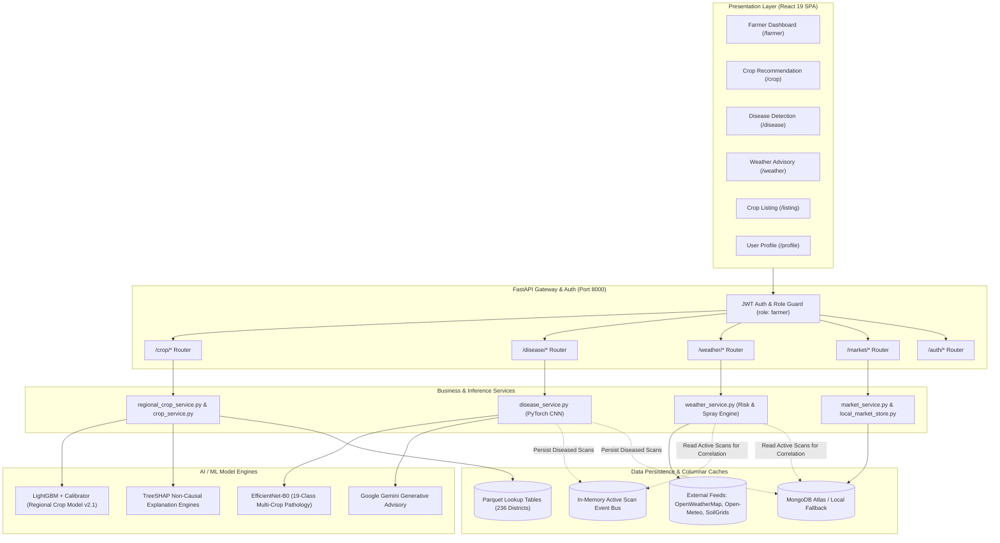
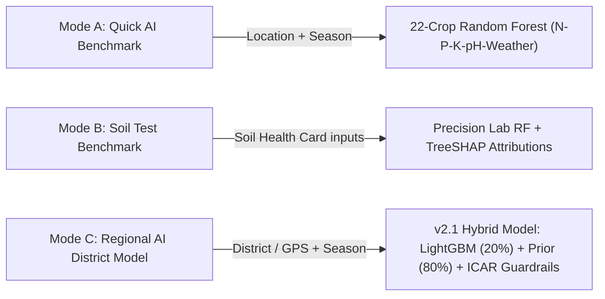
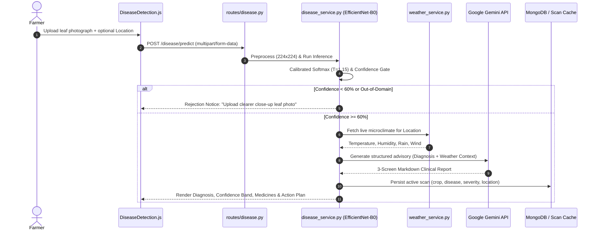
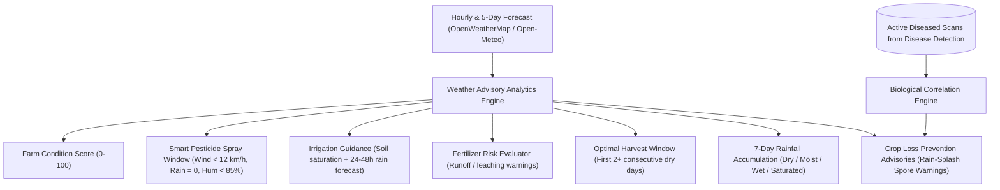
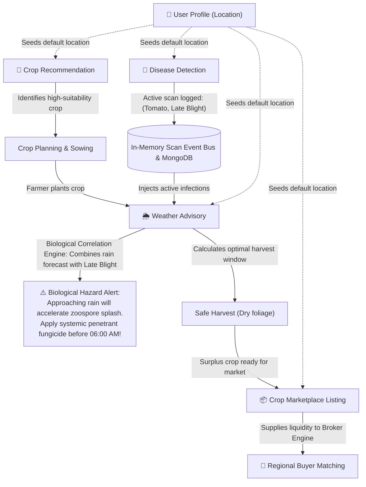

# ALIP Farmer Module: Comprehensive Technical Architecture & Feature Report

**Platform:** AgriLink Intelligence Platform (ALIP)  
**Target User Persona:** Indian Agricultural Producers (Smallholders, Commercial Farmers, Farmer Producer Organizations)  
**System Version:** `v2.1-hybrid`  
**Document Status:** Master Engineering & Functional Architecture Blueprint  
**Date:** October 2026  

---

## 1. Executive Summary & Module Mission

The **Farmer Module** in ALIP is an integrated, end-to-end agricultural decision-support ecosystem. Rather than functioning as a collection of isolated utilities, it acts as an intelligent digital agronomist and market bridge accompanying the farmer across the **complete lifecycle of cultivation**:

```
[Pre-Sowing & Planning]        [In-Season Crop Care]       [Weather & Operations]        [Post-Harvest & Market]
   Crop Recommendation    ──>    Disease Detection   ──>     Weather Advisory     ──>       Crop Listing
(AI Ranking + Chemistry)       (Vision AI + Gemini)       (Biological Coupling)        (Direct Market Liquidity)
```

The module is engineered to bridge the digital divide in Indian agriculture through four core tenets:
1. **Biophysical & Spatial Grounding:** Utilizing real Indian agro-climatic normals, soil chemistry profiles, and irrigation infrastructure rather than abstract heuristic assumptions.
2. **Cross-Module Biological Coupling:** Diagnoses made in one submodule automatically inform recommendations in another (e.g., foliar fungal scans dynamically trigger pre-rain zoospore splash warnings in the weather advisory).
3. **Zero False Guarantees:** Strict adherence to agricultural decision-support ethics—replacing deceptive "yield percentage guarantees" with calibrated historical probabilities, suitability indices, and ICAR-backed agronomic guardrails.
4. **Direct Market Disintermediation:** Seamlessly transitioning harvested crops directly into the commercial broker trading engine to bypass predatory village middlemen.

---

## 2. High-Level Architecture & Technology Stack

The Farmer Module is architected as an asynchronous, decoupled, multi-tier system:



### Technology Matrix
- **Frontend:** React 19, React Router v6, Axios with JWT request interceptors, Framer Motion animations, Lucide React icons, React Hot Toast notifications.
- **Backend Framework:** FastAPI (Python 3.10 asynchronous execution), Pydantic v2 validation schemas.
- **Deep Learning & Computer Vision:** PyTorch (`torchvision` EfficientNet-B0), PIL image processing.
- **Tabular Machine Learning:** LightGBM, XGBoost, Scikit-Learn (Random Forest, Isotonic Regression), SHAP (`TreeExplainer`).
- **External Feeds & APIs:** OpenWeatherMap API, Open-Meteo ERA5 Historical Reanalysis, ISRIC SoilGrids REST API, Google GenAI SDK.
- **Persistence Layer:** MongoDB (scans, listings, users, shipments) backed by bounded in-memory fallbacks and high-performance Parquet columnar stores for sub-second serving.

---

## 3. Deep Dive into Core Features

---

### Feature 1: Crop Recommendation Engine (`/crop`)

The Crop Recommendation Engine helps farmers determine the optimal crop to cultivate. It provides **three distinct operational modes** to accommodate farmers with different levels of technical and laboratory access:



#### Mode A: Quick AI Benchmark (Auto Mode)
- **Input:** Farmer specifies only `Location` (City/District) and `Season` (Kharif, Rabi, Summer).
- **Mechanism:** Automatically fetches regional baseline soil profiles (`N`, `P`, `K`, `pH`) from the internal database and queries live weather via OpenWeatherMap.
- **Model:** Pre-trained Random Forest evaluating 22 Indian agricultural crops.
- **Output:** Ranked recommendations with confidence percentages, agronomic guide (duration, sowing/harvest months, water needs, MSP prices), and farming tips.

#### Mode B: Soil Test Benchmark (Manual Mode)
- **Input:** Designed for farmers holding an official government **Soil Health Card (SHC)**. Inputs: Nitrogen ($N$), Phosphorus ($P$), Potassium ($K$), Soil pH, Temperature, Humidity, and Rainfall.
- **Mechanism:** Passes exact laboratory chemical values directly into the model without heuristic overrides.
- **Explainability:** Renders a dedicated **SHAP Feature Impact Panel** illustrating exactly which nutrient or atmospheric variable had the highest positive or negative influence on the recommendation.

#### Mode C: Regional AI District Model (`v2.1-regional-hybrid`)
The flagship decision model for district-level field crops:
- **Spatial Resolution & Concordance:** Resolves farmer locations via polygon intersection, canonical name lookup, or Haversine distance with a strict **$50\text{ km}$ cutoff**. If unresolved, it abstains gracefully.
- **25-Dimensional Biophysical Vector:** Evaluates 10 environmental factors (10-year trailing temperature, seasonal rainfall, rainfall variability, preceding monsoon rainfall, 0–30 cm soil pH, organic carbon, clay, CEC, lagged irrigation share, season flag) alongside 15 one-hot candidate field crops (`rice`, `wheat`, `maize`, `cotton`, `soybean`, `groundnut`, `chickpea`, `mustard`, `lentil`, `barley`, `jowar`, `bajra`, `pigeonpeas`, `mungbean`, `ragi`).
- **Validation-Tuned Hybrid Ranker:** Blends calibrated ML probabilities with the district's historical cultivation frequency:
  $$S_{\text{hybrid}} = 0.20 \cdot P_{\text{ML}} + 0.80 \cdot P_{\text{prior}}$$
  Achieves a test **$\text{NDCG@3} = 0.9128$** and **$\text{Recall@3} = 0.9316$**.
- **Agronomic Guardrails v1.0.0:** Deterministically enforces ICAR guidelines (hard seasonal exclusions; soft warning flags for extreme heat, drought, or pH imbalance).
- **Presentation Integrity:** Renders scores as a **Suitability Index / Rank Score** with explicit disclaimers: *"Rank Score reflects historical regional probability — not a farm-level yield guarantee."*

---

### Feature 2: AI Leaf Disease Detection & Multi-Crop Pathology (`/disease`)

The Disease Detection module enables farmers to diagnose foliar plant diseases instantly in the field using a smartphone camera.



#### Technical Specifications
- **Deep Learning Architecture:** **EfficientNet-B0** convolutional neural network with custom classification head (Dropout $p=0.40$ + Linear layer) trained across **19 pathology classes** for 4 critical crops:
  - **Tomato:** Bacterial Spot, Early Blight, Late Blight, Leaf Mold, Septoria Leaf Spot, Spider Mites, Target Spot, Mosaic Virus, Yellow Leaf Curl Virus, Healthy.
  - **Potato:** Early Blight, Late Blight, Healthy.
  - **Corn / Maize:** Cercospora Gray Leaf Spot, Common Rust, Northern Leaf Blight, Healthy.
  - **Pepper / Chilli:** Bacterial Spot, Healthy.
- **Softmax Temperature Calibration & Out-of-Domain Rejection:** Uses a temperature parameter ($T = 1.15$) and confidence gates:
  - $\ge 80\%$: High confidence diagnosis.
  - $60\% - 79\%$: Low confidence diagnosis with verification advisory.
  - $< 60\%$: Automated rejection to prevent hallucinated treatments on blurry photos, soil, hands, or weeds.
- **Multi-Screen Clinical UI:**
  - **Screen 1: Action Plan & Medicines:** Urgency timeframe (e.g. *"Start within 24 hours"*), tiered medicine recommendations (🥇 1st Choice, 🥈 2nd Choice, 🥉 3rd Choice with exact chemical names like Metalaxyl-M, Mancozeb, Azoxystrobin), and a step-by-step checklist for the day.
  - **Screen 2: Why This Happened & Prevention Checklist:** Underlying environmental drivers (e.g. prolonged leaf wetness, overhead irrigation splashing), preventative practices, and interactive expandable FAQ.
  - **Screen 3: Detailed AI Technical Report:** Full pathological markdown diagnosis with severity levels, model confidence, and microclimate parameters.

---

### Feature 3: Dynamic Weather Advisory & Farm Operations Engine (`/weather`)

The Weather Advisory module translates raw meteorological data into **timed, practical agricultural field decisions**.



#### Core Analytical Components
1. **Farm Suitability Score (0–100):** A composite index evaluating temperature comfort, relative humidity, wind velocity, precipitation intensity, and thunderstorm codes.
2. **Dynamic Spray Window Algorithm:** Scans the next 48 hours of 3-hour forecast slots to identify the earliest window where $\text{wind} < 12\text{ km/h}$, $\text{rain} = 0$, and $\text{humidity} < 85\%$. Categorizes windows as `safe` (e.g., *"06:00 AM – 09:00 AM"*) or `unsafe` (*"High wind or rainfall risks chemical wash-off and drift"*).
3. **Irrigation Advisory:** Analyzes soil saturation and incoming rain. Recommends "Skip" if rainfall $> 5\text{ mm}$, "Delay" if rain is imminent tomorrow, or "Irrigate normally" during dry spells.
4. **Fertilizer Runoff Warning:** Flags fertilizer application as `unsafe` if rain $> 2\text{ mm}$ is expected within 24 hours, preventing financial loss from nutrient leaching.
5. **Harvest Window Detection:** Evaluates the 5-day horizon to find the first window with $2+$ consecutive dry days ($\text{rain} = 0\text{ mm}$, $\text{humidity} < 80\%$) to prevent post-harvest mold and rotting.
6. **7-Day Cumulative Rainfall & Soil Saturation:** Computes total precipitation and estimates ground moisture states: *Dry*, *Moist*, *Wet*, or *Saturated* (waterlogged).

---

### Feature 4: Direct Crop Marketplace Listing (`/listing`)

The Crop Listing module links agricultural production directly to the **ALIP Commercial Broker & Trading Engine**.

- **Workflow:** Once a farmer harvests their crop, they post a live market listing containing:
  - `Farmer Name`
  - `Location / District`
  - `Crop Name`
  - `Available Quantity (kg)`
  - `Target Price per kg (₹)`
  - `Contact Phone Number`
- **Market Integration:** Submitting a listing triggers `POST /market/listing/add`, which immediately updates the **Broker Regional Supply Registry**. Brokers and institutional buyers monitoring supply in that district can view, match, and bid on the harvest, bypassing predatory village middlemen.

---

### Feature 5: Farmer Profile & Central Management (`/profile`)

The Farmer Profile provides administrative and operational overview:
- **Identity & Role Badge:** Displays user verification status with `👨‍🌾 Farmer` designation.
- **Location Synchronization:** Farmers can update their primary farming district, which automatically re-centers default weather queries and regional crop models.
- **Activity Metrics:** Tracks total engagement:
  - 🔬 *Disease Scans completed*
  - 🌦️ *Weather Advisory checks*
  - 🌱 *Crop Recommendations generated*
  - 📦 *Active Market Listings published*

---

## 4. Cross-Feature Interconnectivity Matrix

The core differentiator of ALIP is that its submodules are tightly interconnected through shared state, cached events, and biological feedback loops:



### Key Synergistic Connections:

| Source Module | Target Module | Data Exchanged | Operational Outcome |
| :--- | :--- | :--- | :--- |
| **Disease Detection** | **Weather Advisory** | `scan_id`, `crop`, `disease`, `severity`, `location` | **Biological Correlation:** Weather Advisory detects upcoming rain and warns that moisture will accelerate fungal zoospore spread, providing an urgent pre-rain systemic fungicide spray deadline. |
| **Disease Detection** | **Weather Advisory** | Safe spray window timing | The treatment plan generated in Disease Detection references the exact hourly morning spray window calculated by the weather engine. |
| **Crop Recommendation** | **Crop Listing** | Crop variety & expected yield | Sowing decisions made via Crop Recommendation flow directly into crop types and quantity expectations listed in the marketplace. |
| **Crop Listing** | **Broker Demand Engine** | `quantity_kg`, `price_per_kg`, `location` | Farmer listings dynamically feed the platform's supply-demand curve, alerting buyers when local supply is abundant or scarce. |
| **User Profile** | **All Modules** | Default District / Lat-Lon | A single location update in the profile automatically configures weather stations, regional district lookups, and local mandi prices. |

---

## 5. Security, Ethics, and Agronomic Guardrails

1. **Authentication & Role-Based Access Control (RBAC):**
   - Secured with JWT bearer tokens (`Authorization: Bearer <token>`).
   - Role-based route protection on both frontend (`<ProtectedRoute role="farmer">`) and backend ensures brokers cannot alter farmer listings or scans.
2. **Ethical Framing & No Yield Guarantees:**
   - Models avoid deceptive claims like *"98% yield guaranteed"*.
   - Explanations are framed associatively using TreeSHAP: *"Seasonal rainfall supports this crop's water needs"* rather than making unsubstantiated causal promises.
3. **Chemical Safety Guardrails:**
   - Pesticide advice is accompanied by strict warnings (e.g. *"Do not spray when wind > 16 km/h to prevent chemical drift onto neighbouring fields or water bodies"*).
   - Copper bactericides include mandatory warnings against mechanical handling during wet canopy conditions.
4. **Boundary & Regional Abstention:**
   - If an input location is $> 50\text{ km}$ from known Indian agricultural districts or falls into the ocean, the system abstains with a $404$ notice directing the farmer to their nearest Krishi Vigyan Kendra (KVK).

---

## 6. Summary of Farmer Module Routes & Endpoints

### Frontend URL Sitemap
- `/farmer` — Central Farmer Welcome Dashboard
- `/crop` or `/farmer/crop` — 3-Tab Crop Recommendation Engine (Auto, Manual, Regional v2.1)
- `/disease` or `/farmer/disease` — AI Leaf Disease Diagnosis & Multi-Screen Clinical Action Plan
- `/weather` or `/farmer/weather` — Weather Advisory, Farm Suitability Index & Bio-Coupled Warnings
- `/listing` — Add Crop Listing to Marketplace
- `/profile` — Farmer Profile & Farm Management Stats

### Backend REST API Interface
- `POST /crop/recommend` — Quick AI Auto Mode (Location + Season)
- `POST /crop/recommend/manual` — Soil Health Card Precision Mode (NPK + pH)
- `POST /crop/recommend/regional` — Production Regional Hybrid Model (`v2.1-regional-hybrid`)
- `POST /disease/predict` — Multipart image upload for EfficientNet-B0 disease detection
- `GET /disease/active-scans/{location}` — Queries unresolved disease outbreaks in the region
- `POST /disease/scan/{scan_id}/resolve` — Marks an infection as treated/cured
- `GET /weather/dashboard/{location}?crops=tomato,potato` — Full farm weather dashboard with spray windows and disease risk
- `POST /market/listing/add` — Adds a farmer crop harvest listing to the marketplace registry
- `GET /auth/profile/{user_id}` & `PUT /auth/profile/{user_id}` — Farmer profile management

---

### Conclusion
The **ALIP Farmer Module** provides a scientifically grounded, technically rigorous decision-support architecture. By fusing **deep vision pathology**, **regional biophysical ML ranking**, **hourly weather optimization**, and **direct market access**, it equips Indian farmers with actionable, verifiable intelligence from seed to sale.
